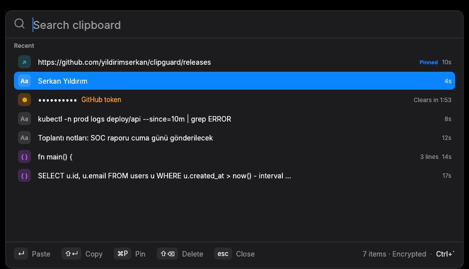

# clipguard

**A clipboard manager that doesn't leak your secrets.**
Searchable clipboard history like Ditto, built security-first: encrypted at rest, secrets auto-expire, password managers respected, no network at all.

Windows · macOS · Linux — written in Rust.



## Why

Classic clipboard managers keep everything you copy, forever, in plain text. That includes passwords, API keys and tokens. Some also listen on the network to sync clips.

clipguard keeps the part people love, the full searchable history, and removes the risk:

| | Typical clipboard manager | clipguard |
|---|---|---|
| History on disk | Plain text database | AES-256-GCM, key in the OS keystore |
| Secrets (tokens, keys, passwords) | Kept forever | Detected, removed after 120 s, clipboard wiped |
| Password managers | Often recorded anyway | Respected: never stored |
| Network | Optional sync, open port | None. No sockets, no telemetry |
| Duplicate detection | Plain hash (reveals what was copied) | Keyed HMAC |

## Features

- **Instant search**: fuzzy search across your history, Spotlight-style window
- **Keyboard first**: open with a hotkey, arrow keys, Enter to paste
- **Pin** clips you reuse; pinned clips are kept
- **Long history**: 90 days or 10,000 clips by default
- **Secret detection**: AWS, GitHub, GitLab, Slack, Google, Stripe, Anthropic and OpenAI keys, JWTs, bearer tokens, credentials in URLs, `password=` assignments, PEM private keys, Azure storage keys, and generated passwords. Secrets are never shown on screen
- **Tray icon**: pause capture, start at login, quit
- **Enterprise friendly**: per-machine MSI with silent install; start-at-login is per user

## Install

Download from [Releases](https://github.com/yildirimserkan/clipguard/releases/latest).

**Windows**
- `clipguard-<version>-x64.msi`: installs to Program Files (needs admin)
- `clipguard-<version>-windows-x64-portable.zip`: single `clipguard.exe`, no install
- Silent install for IT: `msiexec /i clipguard-<version>-x64.msi /qn`

> The binaries are not code-signed yet, so SmartScreen may warn: **More info → Run anyway**.

**macOS** (Apple Silicon)
```sh
tar -xzf clipguard-<version>-macos-arm64.tar.gz
xattr -d com.apple.quarantine clipguard   # unsigned binary
./clipguard
```
Auto-paste needs **System Settings → Privacy & Security → Accessibility**. Without it, clips are still copied; paste with ⌘V.

**Linux** (x64, X11)
```sh
tar -xzf clipguard-<version>-linux-x64.tar.gz
./clipguard
```
Needs a Secret Service keyring (GNOME Keyring, KWallet, KeePassXC).

Verify any download against `SHA256SUMS.txt` from the same release.

## Usage

| Key | Windows / Linux | macOS |
|---|---|---|
| Open / hide | <kbd>Ctrl</kbd>+<kbd>\`</kbd> (fallback <kbd>Ctrl</kbd>+<kbd>Shift</kbd>+<kbd>\`</kbd>, <kbd>Win</kbd>+<kbd>Shift</kbd>+<kbd>V</kbd>) | <kbd>Cmd</kbd>+<kbd>Shift</kbd>+<kbd>C</kbd> (fallback <kbd>Ctrl</kbd>+<kbd>Shift</kbd>+<kbd>V</kbd>) |
| Move | `↑` `↓` | `↑` `↓` |
| Paste into previous app | `Enter` | `Enter` |
| Copy only | `Shift+Enter` | `Shift+Enter` |
| Pin / unpin | `Ctrl+P` | `Cmd+P` |
| Delete | `Del`, or hover a row and click **×** | `Cmd+Backspace`, or **×** |
| Hide | `Esc` | `Esc` |

The active hotkey is shown in the window's footer. If another app (e.g. Ditto) already holds <kbd>Ctrl</kbd>+<kbd>\`</kbd>, clipguard uses the next free one.

Drag the window by the search icon or the footer. Closing the window only hides it; clipguard keeps running in the tray.

## Security model

**What is protected**
- Clip contents on disk are encrypted per item with AES-256-GCM. Each ciphertext is bound to its row, so rows cannot be swapped or tampered with undetected.
- The master key is random, created on first run and stored only in the OS keystore: Windows Credential Manager (DPAPI), macOS Keychain, or Linux Secret Service. It never touches disk in plain form. If no keystore is available, clipguard refuses to run rather than fall back to a key file.
- Deleted rows are overwritten (`secure_delete`). On Unix the database is `0600` in a `0700` directory.
- Clips marked by password managers are never read into history:
  `ExcludeClipboardContentFromMonitorProcessing`, `Clipboard Viewer Ignore`, `CanIncludeInClipboardHistory=0` (Windows), `org.nspasteboard.ConcealedType` and friends (macOS), `x-kde-passwordManagerHint` (Linux/X11).
- Detected secrets are deleted 120 s after their last copy, even if pinned. If the secret is still on the system clipboard at that moment, the clipboard is cleared too.
- No network code. No update checks, no telemetry, no sync.

**What is not protected**
- Malware running as *your* user can ask the keystore for the key, just as clipguard does. Encryption at rest protects against disk theft, backups, other users and offline analysis, not against a compromised session.
- Timestamps and pin/secret flags are stored unencrypted so retention can run without decrypting anything.
- Secret detection is pattern-based. Unknown secret formats may be stored as normal clips.
- There is a millisecond window between checking password-manager markers and reading the text.

## Data

| | Windows | macOS | Linux |
|---|---|---|---|
| Database | `%APPDATA%\clipguard\data\clips.db` | `~/Library/Application Support/clipguard/clips.db` | `~/.local/share/clipguard/clips.db` |
| Key | Credential Manager, `clipguard` | Keychain, `clipguard` | Secret Service, `clipguard` |

To erase your history completely: quit clipguard, delete the database, then delete the `clipguard` keystore entry. Uninstalling the MSI removes the program only, not each user's history.

## Known limitations

- Linux Wayland: global hotkeys and background clipboard monitoring are restricted by the compositor; X11 and XWayland work.
- GNOME shows the tray icon only with the *AppIndicator and KStatusNotifierItem Support* extension.
- Text clips only for now.

## Build from source

```sh
git clone https://github.com/yildirimserkan/clipguard
cd clipguard
cargo build --release      # target/release/clipguard
cargo test
```
Linux build deps: `libxcb1-dev libxcb-xfixes0-dev`.

## License

MIT, see [LICENSE](LICENSE).
Bundles the [Inter](https://rsms.me/inter/) font under the SIL Open Font License ([assets/fonts/Inter-LICENSE.txt](assets/fonts/Inter-LICENSE.txt)).

---

### Türkçe

**clipguard**, Ditto benzeri ama güvenlik odaklı bir pano yöneticisi. Geçmiş AES-256-GCM ile şifreli tutulur, anahtar işletim sisteminin anahtar deposundadır. Token, API anahtarı ve parola gibi gizli bilgiler 120 saniye sonra silinir, parola yöneticilerinin kopyaları hiç kaydedilmez. Ağ bağlantısı yoktur. Kurulum için [Releases](https://github.com/yildirimserkan/clipguard/releases/latest) sayfasından MSI veya taşınabilir zip'i indirin.
